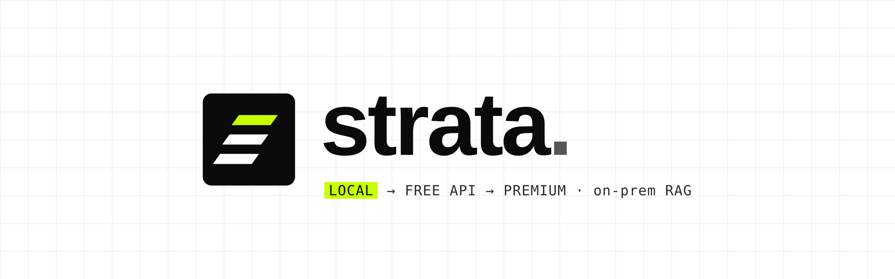
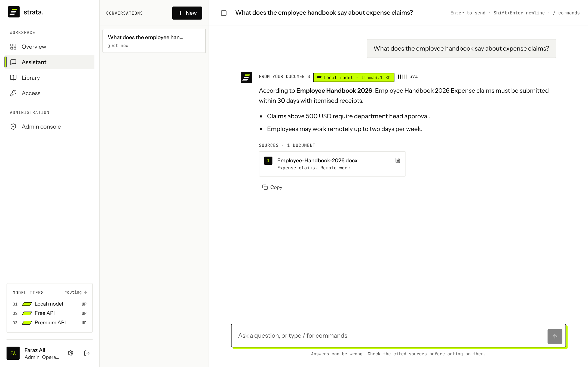
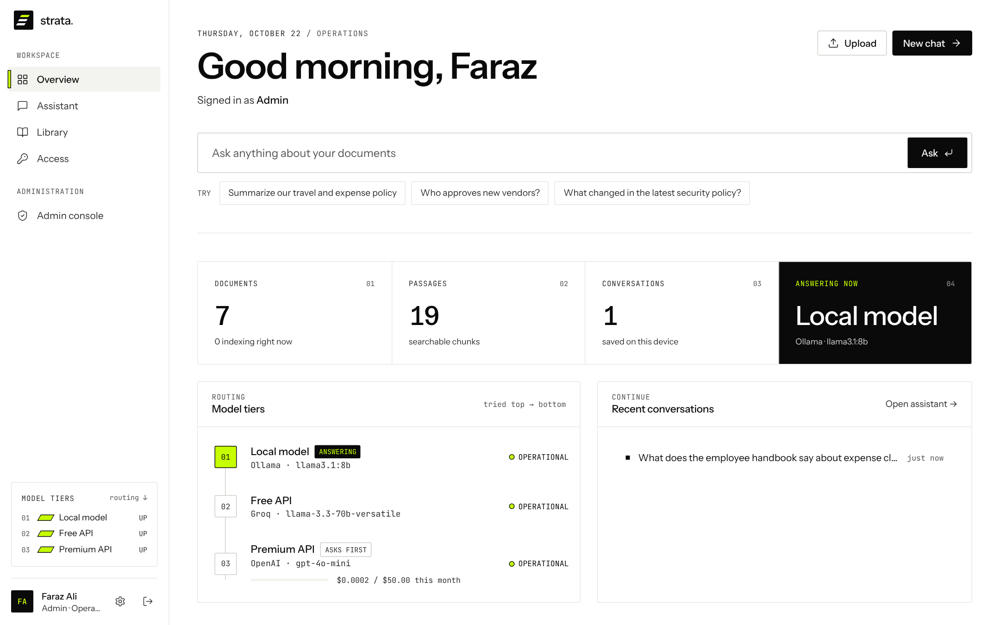
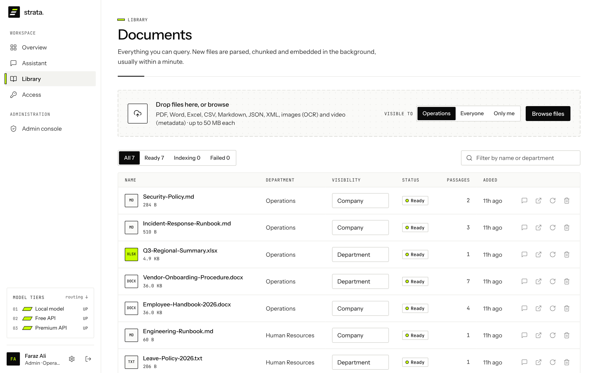
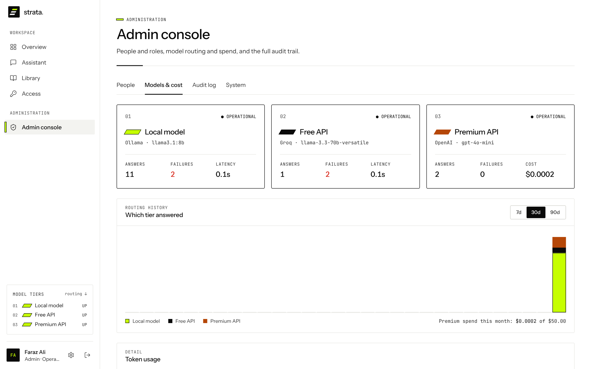
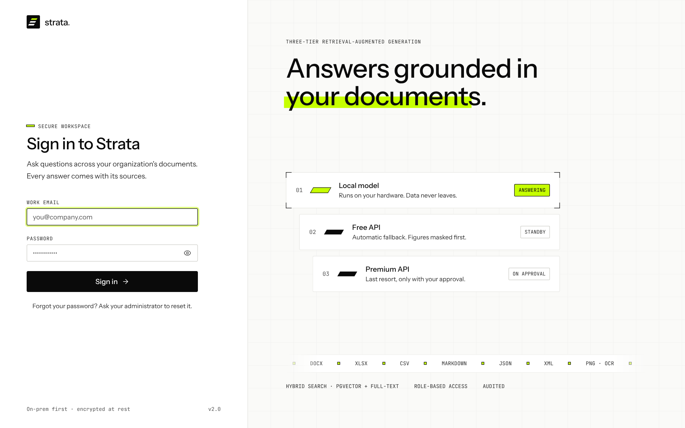
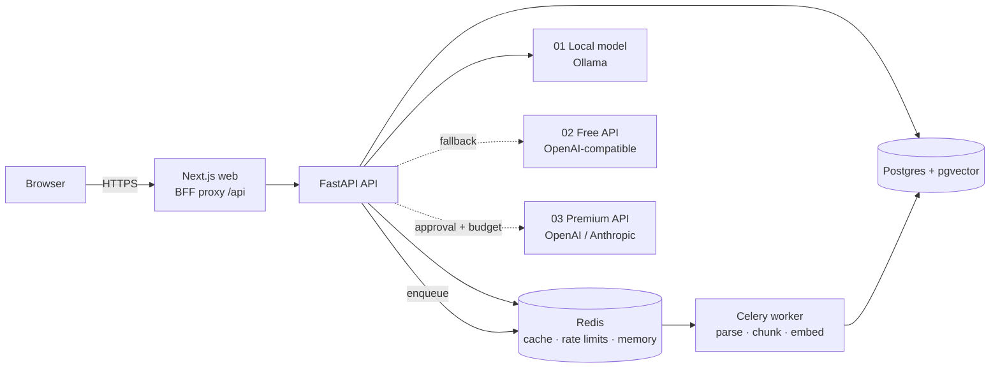

<p align="center">
  
</p>

<h1 align="center">Strata: Enterprise Knowledge Intelligence &amp; Tiered LLM Orchestration</h1>

<p align="center">
  <b>On-prem-first, three-tier retrieval-augmented generation for your organization's documents.</b><br>
  Answers come from your files, with sources. The local model answers first; a free API and a paid API are fallbacks you control.
</p>

<p align="center">
  <a href="#quick-start">Quick start</a> ·
  <a href="docs/architecture.md">Architecture</a> ·
  <a href="docs/configuration.md">Configuration</a> ·
  <a href="docs/deployment.md">Deployment</a> ·
  <a href="SECURITY.md">Security</a>
</p>

---

<p align="center"></p>

## Why Strata

Most RAG tools send every question to a cloud model. Strata routes each answer through three **tiers**, top to bottom:

| # | Tier | Default | When it's used |
|---|------|---------|----------------|
| 01 | **Local model** | Ollama · `llama3.1:8b` | Always tried first. Runs on your hardware, so data never leaves. |
| 02 | **Free API** | Groq · any OpenAI-compatible endpoint | Automatic fallback when the local model is down or overloaded. |
| 03 | **Premium API** | OpenAI or Anthropic | Last resort. Needs the user's approval each time and stays under a monthly budget. |

Before any text reaches an external tier, financial figures are masked. A tier that fails is skipped for 30 s (circuit breaker), so one dead backend doesn't add its timeout to every question. Every call is logged with its tier, tokens, latency and cost.

## Features

- **Grounded answers with citations.** Hybrid retrieval (pgvector HNSW + Postgres full-text, fused with RRF) and a cross-encoder reranker. When the documents don't hold the answer, Strata says so; general-knowledge answers are clearly labelled.
- **Streaming chat** with `/file` (ask one document in isolation), conversation memory, near-duplicate detection and source cards that open the original file.
- **Ingestion pipeline.** PDF (tables kept as header/value pairs), DOCX, XLSX, CSV, Markdown, JSON, XML, images (OCR) and video (metadata only). Parsing runs on Celery workers with retries, and a sweeper re-queues stuck jobs.
- **Role-based access.** Roles: Admin, Department Head, Manager, Member, Guest. Files are company-wide, department-only or private. Cross-department access works through requests that a department head approves once, for a limited time or permanently, and standing auto-approve rules can grant matching requests automatically.
- **Security.** Files are encrypted at rest (Fernet, rotatable keys). Sign-in uses httpOnly cookies with CSRF protection, refresh-token rotation, "sign out everywhere" and brute-force lockout. Requests are rate-limited per role, inputs are checked against prompt injection, and uploads are validated by their magic bytes. An audit trail covers every action and can be exported to CSV.
- **Built-in auth (fully on-prem).** Accounts and bcrypt-hashed passwords live in your own Postgres, so no third-party sign-in service is needed. Supabase Auth is an optional alternative.
- **Admin console.** Manage people and roles, see which tier answered each question, track token usage and premium spend, browse the audit log and check system stats.
- **Production packaging.** Docker Compose stack (Postgres + pgvector, Redis, API, worker, beat, web, optional Ollama) with non-root images, healthchecks, a migrations job, JSON logs and CI.

## Quick start

Requirements: Docker with Compose v2, and roughly 8 GB of RAM for the local model.

```bash
git clone https://github.com/FarazAnjamAli/strata-enterprise-knowledge-intelligence.git
cd strata-enterprise-knowledge-intelligence

# 1. generate .env with fresh secrets
./scripts/setup.sh                                          # Linux / macOS
powershell -ExecutionPolicy Bypass -File scripts\setup.ps1  # Windows

# 2. start everything, including a local Ollama that pulls llama3.1:8b
docker compose --profile local-llm up -d --build
```

Open **http://localhost:3000** and sign in with the admin email and password the setup script printed.

> **Already running Ollama on the host?** Skip the profile and set `OLLAMA_URL=http://host.docker.internal:11434` in `.env`.
>
> **Turn on the fallbacks:** set `FREE_LLM_ENABLED=true` and `FREE_LLM_API_KEY` (e.g. a free Groq key), and/or `PAID_LLM_ENABLED=true` and `PAID_LLM_API_KEY`.

## Screenshots

| Overview | Library |
|---|---|
|  |  |
| **Models & cost** | **Sign in** |
|  |  |

## Architecture



The browser only ever talks to the web app, which proxies `/api/*` to the FastAPI service on the private network. See [docs/architecture.md](docs/architecture.md) for details on the request flow, retrieval and tier routing.

## Repository layout

```
backend/            FastAPI app, Celery workers, Alembic migrations, tests
  app/api/          HTTP routes (auth, chat, files, upload, access, admin, system…)
  app/llm/          three-tier router, provider adapters, prompts, usage/cost
  app/rag/          embeddings, hybrid search, reranker, chunking, memory
  app/parsers/      one parser per file format + magic-byte validation
  app/security/     masking, sanitizer, rate limits, audit, encryption at rest
frontend/           Next.js 15 (App Router) + Tailwind + Motion
  src/app/          pages: login, overview, chat, library, access, admin, settings
  src/app/api/      backend-for-frontend proxy (streams uploads and SSE)
docs/               architecture, configuration, deployment, screenshots
scripts/            setup.sh / setup.ps1 (generate .env)
docker-compose.yml  production stack
```

## Development

```bash
# infrastructure only
docker compose up -d postgres redis

# backend
cd backend
python -m venv .venv && . .venv/bin/activate
pip install torch==2.7.0 --index-url https://download.pytorch.org/whl/cpu
pip install -r requirements-dev.txt
export DATABASE_URL=postgresql://strata:<pw>@localhost:5432/strata REDIS_URL=redis://:<pw>@localhost:6379/0 JWT_SECRET=<32+ chars> ENVIRONMENT=development
alembic upgrade head
uvicorn app.main:app --reload            # API docs at http://localhost:8000/docs
celery -A app.workers.celery_app worker  # in another shell
pytest

# frontend
cd frontend
npm install
BACKEND_URL=http://localhost:8000 npm run dev
```

Operator CLI (run inside the `api` container):

```bash
docker compose exec api python -m app.cli create-user --email ada@company.com --role Admin
docker compose exec api python -m app.cli reset-password --email ada@company.com
docker compose exec api python -m app.cli reindex --failed-only
```

## License

[MIT](LICENSE)
