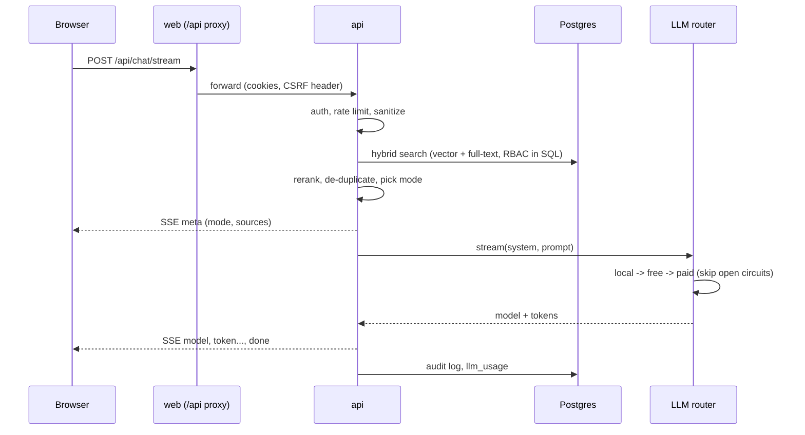

# Architecture

## Services

| Service | Image | Role |
|---|---|---|
| `web` | `frontend/Dockerfile` | Next.js 15 UI. Also a backend-for-frontend: `/api/*` is proxied to the API, so the browser only ever talks to one origin. |
| `api` | `backend/Dockerfile` | FastAPI. Auth, RBAC, retrieval, the LLM tier router, admin and audit. |
| `worker` | same as api | Celery worker: parse, chunk, embed and index uploaded files. |
| `beat` | same as api | Celery beat: re-queues files stuck in `pending` / `processing`. |
| `migrate` | same as api | One-shot `alembic upgrade head` before the API starts. |
| `postgres` | `pgvector/pgvector:pg16` | Relational data, vectors (HNSW) and full-text search (GIN). |
| `redis` | `redis:7-alpine` | Celery broker, embedding cache, rate limits, chat memory, login lockout. |
| `ollama` | `ollama/ollama` | Optional (`--profile local-llm`): the tier 1 local model. |

## Answering a question

### Modes

Retrieval decides what an answer is grounded in:

- `documents`: hybrid search over every file the user may read
- `file`: the same, restricted to one file (`/file` in chat, or naming the file)
- `clarify`: near-identical passages in different files, so the user is asked which one
- `video`: the best hit is a video (metadata only), so the play link is returned
- `general`: nothing matched, so the answer is general knowledge and labelled as such
- `assistant`: greetings and "who are you", answered without retrieval or an LLM

### Hybrid retrieval

1. The query is embedded (`all-mpnet-base-v2`, cached in Redis).
2. Top candidates by cosine distance (pgvector HNSW) and by `ts_rank` (GIN) are fetched, both filtered by the RBAC clause in SQL.
3. The two lists are fused with Reciprocal Rank Fusion, and identical boilerplate chunks are collapsed.
4. A cross-encoder reranker (`ms-marco-MiniLM-L-6-v2`) reorders the fused list and drops clear junk.
5. At most 3 chunks per file are kept, so one large document can't crowd out the rest.

## The three tiers

`app/llm/router.py` walks `LLM_TIER_ORDER` (default `local,free,paid`):

- **Masking.** External tiers always receive the prompt with financial figures masked. The local tier is unmasked unless `MASK_LOCAL_LLM=true`.
- **Circuit breaker.** A tier that errors is moved to the back of the line for `LLM_CIRCUIT_COOLDOWN` seconds. If every healthy tier fails, the tripped local/free tiers get one more try. The paid tier is never retried this way.
- **Paid gating.** The paid tier is skipped when the user's role isn't in `PAID_LLM_ALLOWED_ROLES` or the month-to-date spend has reached `PAID_LLM_MONTHLY_BUDGET_USD`. With `PAID_LLM_REQUIRE_CONFIRMATION=true`, the router raises `PaidConfirmationRequired` and the UI shows the estimated cost and asks before resending with `allow_paid=true`.
- **Accounting.** Every attempt is written to `llm_usage` (tier, provider, model, tokens, latency, success, cost). The admin console reads it.

Provider adapters: Ollama (`/api/generate`), any OpenAI-compatible `/chat/completions` endpoint (Groq, OpenRouter, Together, OpenAI...) and Anthropic `/v1/messages`.

## Ingestion

`POST /api/upload`: the extension is checked against an allow-list, magic bytes are validated, the size limit is enforced, and the file is encrypted with Fernet and written to the uploads volume before a Celery job is queued. The worker decrypts to a temp file, parses it with the format's parser, chunks it (boundary aware, about 512 tokens with 50 of overlap), prefixes each chunk with its document name, embeds it and writes the rows. A database trigger keeps `content_tsv` in sync.

Parse errors are terminal and mark the file `failed` (a webhook `file.failed` is sent). Embedding errors retry three times with backoff. `beat` re-queues files that never got picked up.

## Authentication

- `AUTH_PROVIDER=local` (default): bcrypt passwords in Postgres. The API issues a 15 minute access JWT and a 7 day refresh JWT, both as httpOnly SameSite=Lax cookies. The refresh cookie is scoped to `/api/auth`. Refresh tokens rotate and carry the user's `token_version`, so "sign out everywhere", password changes and deactivation revoke them all.
- `AUTH_PROVIDER=supabase`: the API proxies password sign-in and refresh to Supabase and verifies its JWTs against the project JWKS.
- Cookie-authenticated state-changing requests must carry the `X-Strata-CSRF` header. API clients can use `Authorization: Bearer <access_token>` instead.
- Five failed sign-ins for an email and IP pair lock that pair out for 15 minutes.

## Access control

`visible_files_filter()` in `app/auth/rbac.py` is the single rule composed into every query that touches files or chunks. A user can read a file when it is their own, it is public (except for Guests), it belongs to their department at `department` level, a `file_access_permissions` grant matches their department and role, or they hold an approved and unexpired access request.
