# Screenshots

Captured from a running Strata instance (1440 × 900).

### Sign in

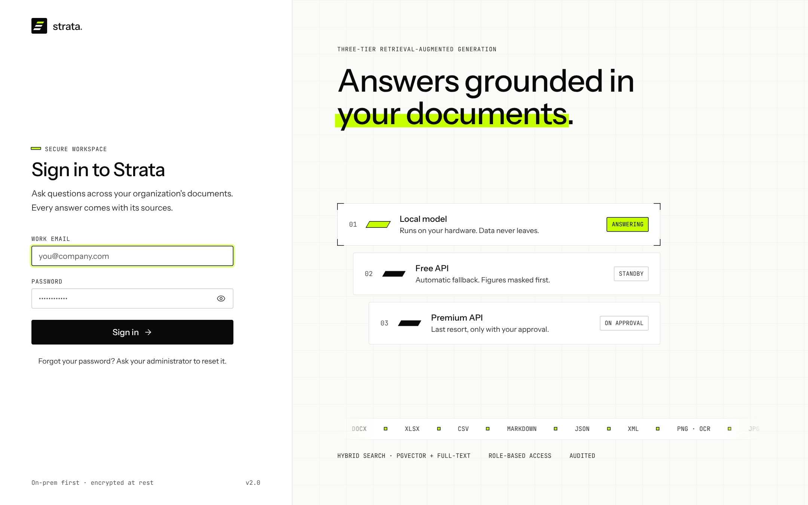

### Overview: tier routing, stats, recent activity

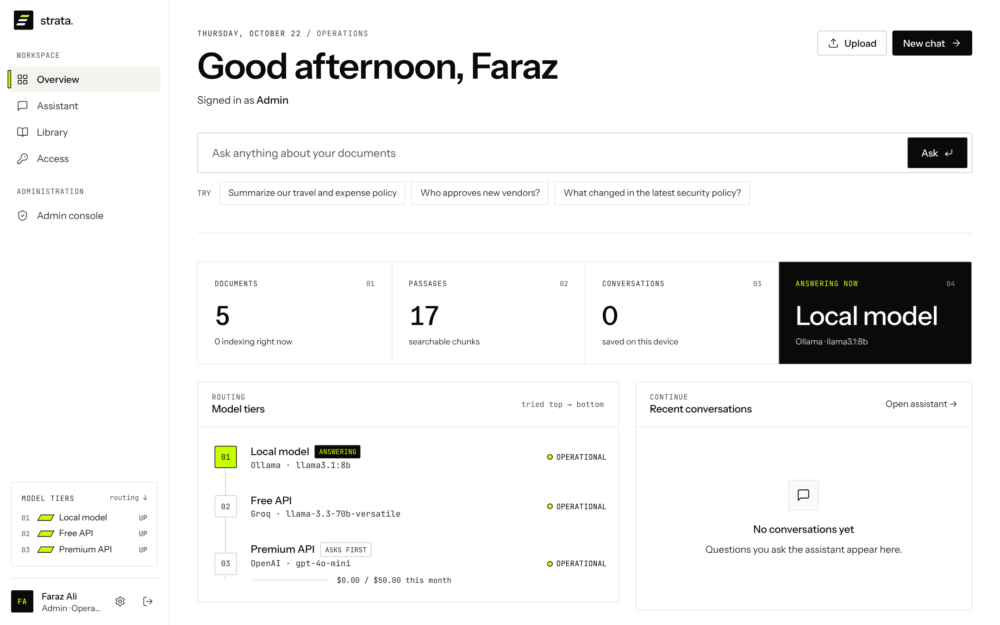

### Assistant: new chat

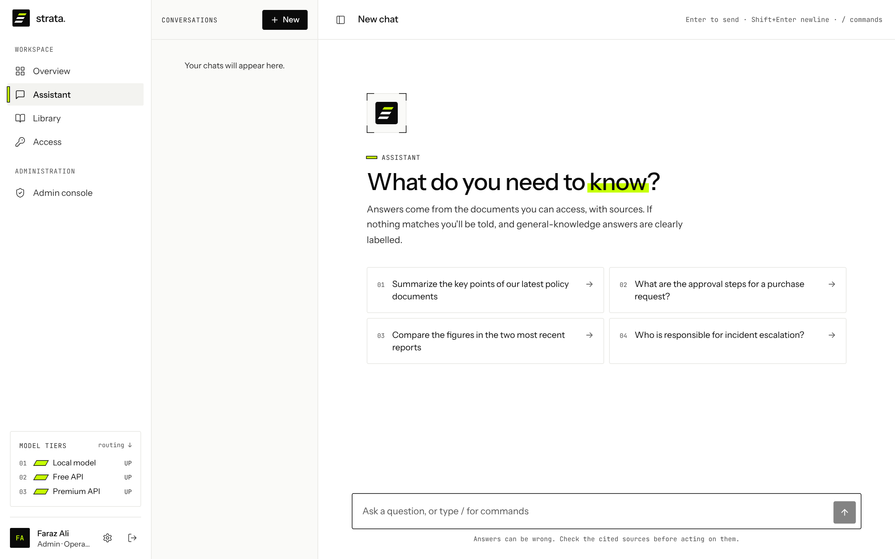

### Grounded answer with model tier, confidence and sources

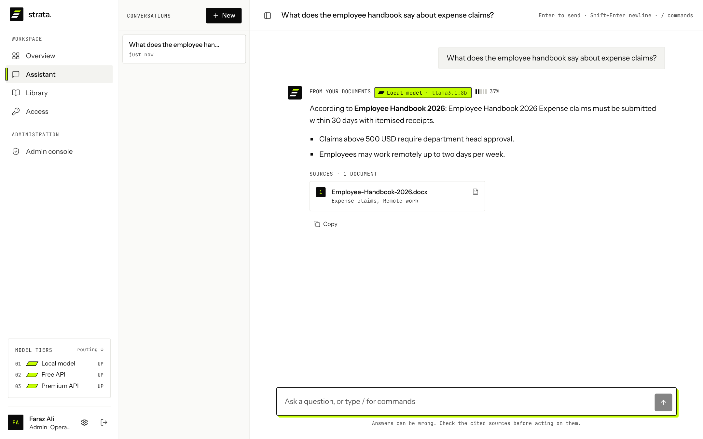

### /file command: pick one document

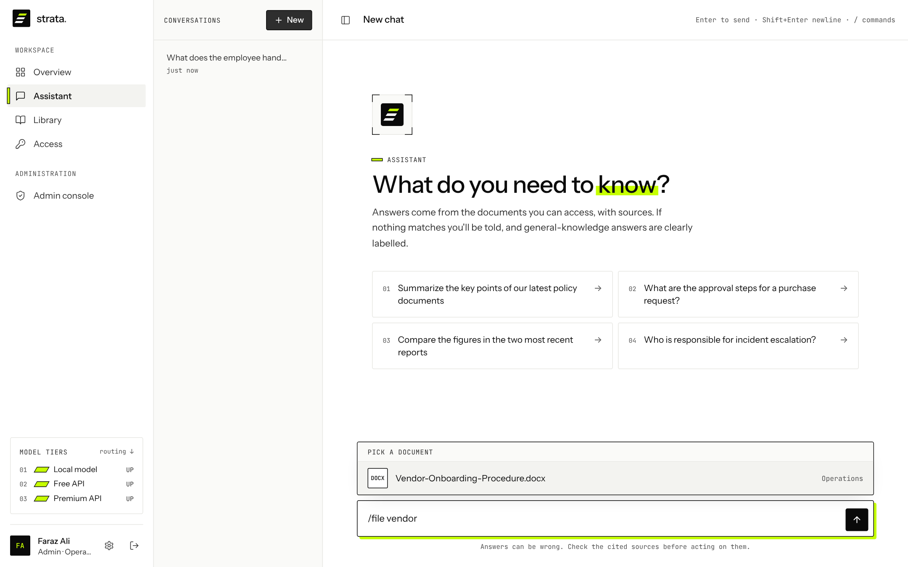

### Answer scoped to a single document

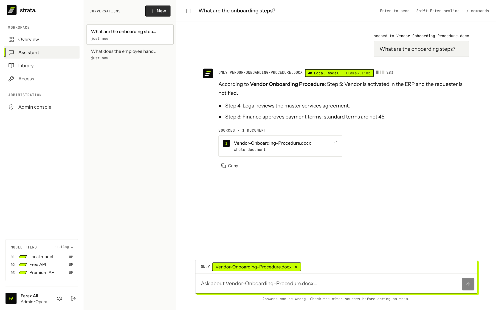

### Local and free tiers down: premium tier asks for approval with estimated cost

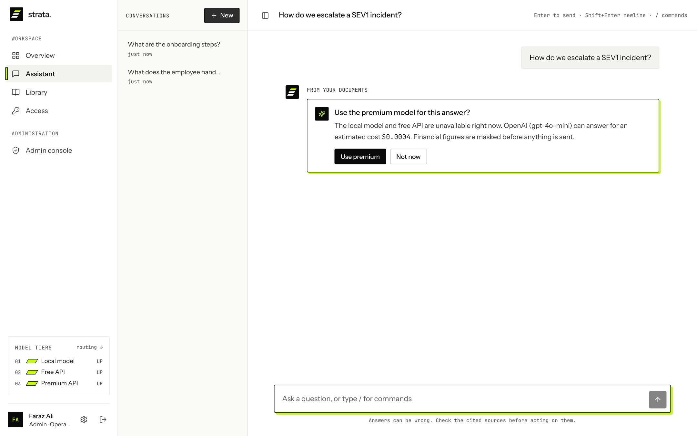

### Library: upload, visibility, indexing status

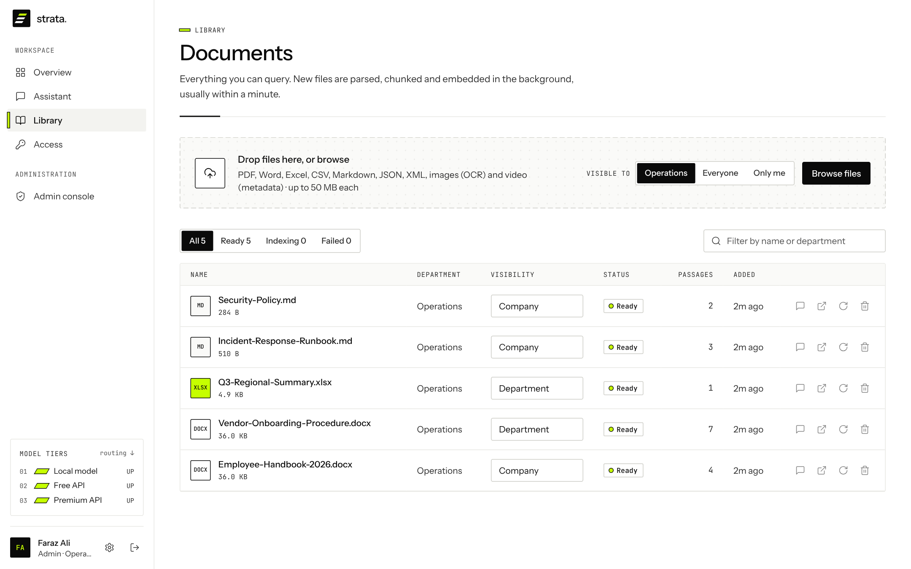

### Cross-team access requests awaiting approval

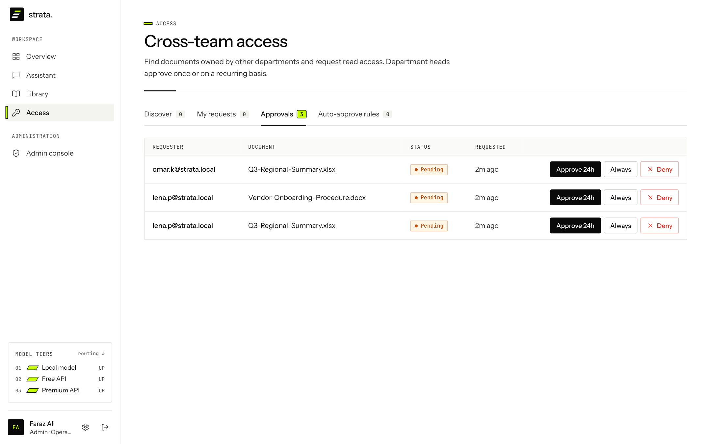

### Admin: people, roles and departments

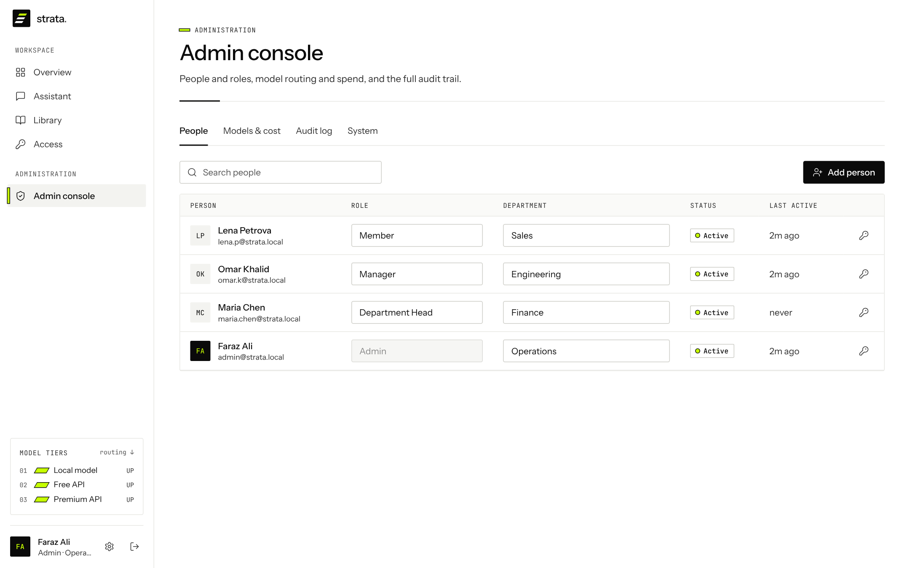

### Admin: which tier answered, failures, latency and cost

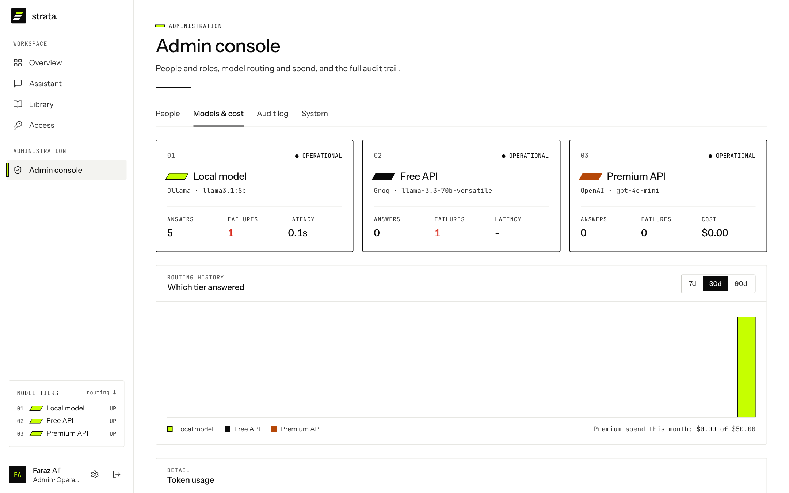

### Admin: audit log with filters and CSV export

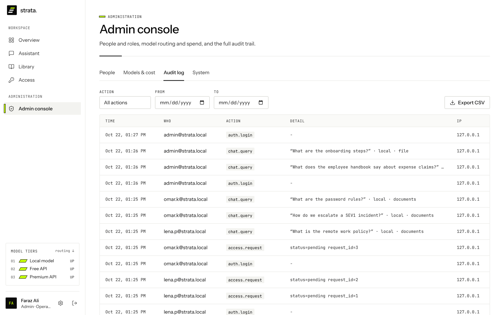

### Admin: system stats

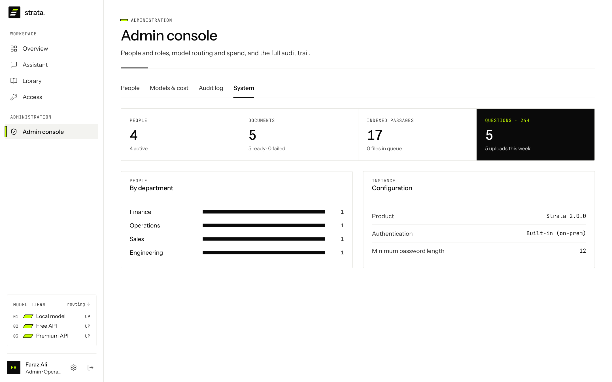

### Settings: profile, password, sessions

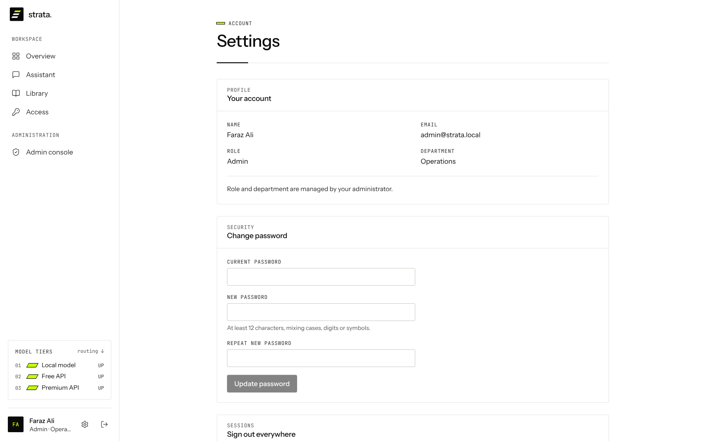
